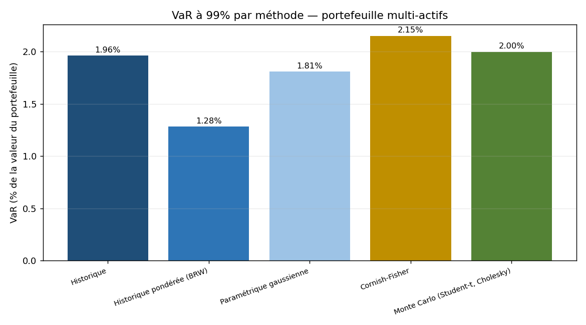

# Market Risk VaR Engine

Python package for the usual market risk reports of an asset manager: VaR and
Expected Shortfall with five methods, VaR backtesting, stress tests and
ex-ante tracking error.

A short note with the method and results: [note/market-risk-var-engine.pdf](note/market-risk-var-engine.pdf).

  

**Data:** the examples run on synthetic returns (multi-asset GARCH(1,1), Bollerslev
(1986), with a Student-t copula), so the numbers below show how the methods behave, not the
risk of a real fund.

## What it covers

| Area | Methods |
|---|---|
| VaR / ES | historical, age-weighted historical (BRW; Boudoukh, Richardson and Whitelaw, 1998), parametric normal, Cornish-Fisher (Cornish and Fisher, 1938), Monte Carlo (Student-t, Cholesky) |
| Backtesting | Kupiec POF (1995), Christoffersen independence and conditional coverage (1998), Basel traffic light (Basel Committee, 1996) |
| Stress tests | historical replay, hypothetical shocks, correlation stress, reverse stress test (Mahalanobis distance) |
| Ex-ante risk | tracking error, beta and Blume-style adjusted beta (Blume, 1975; the rounded 1/3 + 2/3 rule), information ratio, Euler VaR contributions, Ledoit-Wolf covariance (Ledoit and Wolf, 2004) |

## Run

```bash
pip install -e ".[dev]"
python examples/01_var_comparison.py
python examples/02_var_backtest.py
python examples/03_stress_tests.py
python examples/04_ex_ante_risk.py
pytest tests -q
```

## Results

Portfolio: 30% EU equities, 30% US equities, 20% government bonds, 15% IG
credit, 5% gold. 1,500 days.

**VaR and ES, one day, 99%**

| Method | VaR | ES |
|---|---|---|
| Historical | 1.96% | 2.38% |
| Age-weighted historical (BRW) | 1.28% | 2.38% |
| Parametric normal | 1.81% | 2.08% |
| Cornish-Fisher | 2.15% | 3.09% |
| Monte Carlo Student-t | 2.00% | 2.52% |

Cornish-Fisher gives the highest numbers because it adjusts for skewness and
fat tails. The normal model gives the lowest ES. The age-weighted row uses a
decay of 0.94, the daily RiskMetrics value (J.P. Morgan/Reuters, 1996).



**Backtest over 250 days** (500-day rolling window): 4 exceptions (1.6% vs
1% expected). Kupiec p = 0.38 and Christoffersen p = 0.72, so the model is not
rejected. Basel traffic light: green zone.

**Stress tests:** 2008 replay -27.7%, COVID March 2020 -21.9%, 2022 rate shock
-15.3%. Setting all correlations to 1 raises portfolio volatility from 12.5% to
16.0%. The most likely shock that causes a 15% loss is mainly on equities
(EU -20.7%, US -26.3%).

**Ex-ante tracking error:** forecast 2.13% vs 1.68% realised over the next 250
days. Over 48 rolling windows, realised TE is on average 1.17x the forecast.
Equities make up 94% of the one-day VaR (Euler decomposition).

## Limitations

- Synthetic data. The historical scenarios are approximations of real crises.
- Linear positions only (no option gamma or vega).
- The parametric VaR and the Euler decomposition assume normal returns.

## References

- Basel Committee on Banking Supervision (1996). Supervisory framework for the use of "backtesting" in conjunction with the internal models approach to market risk capital requirements. https://www.bis.org/publ/bcbs22.htm
- Blume, M. E. (1975). Betas and their regression tendencies. Journal of Finance, 30(3), 785-795. https://doi.org/10.1111/j.1540-6261.1975.tb01850.x
- Bollerslev, T. (1986). Generalized autoregressive conditional heteroskedasticity. Journal of Econometrics, 31(3), 307-327. https://doi.org/10.1016/0304-4076(86)90063-1
- Boudoukh, J., Richardson, M. and Whitelaw, R. (1998). The best of both worlds: a hybrid approach to calculating value at risk. Risk, 11, 64-67. Working paper: https://doi.org/10.2139/ssrn.51420
- Christoffersen, P. F. (1998). Evaluating interval forecasts. International Economic Review, 39(4), 841-862. https://doi.org/10.2307/2527341
- Cornish, E. A. and Fisher, R. A. (1938). Moments and cumulants in the specification of distributions. Revue de l'Institut International de Statistique, 5(4), 307-320. https://doi.org/10.2307/1400905
- J.P. Morgan/Reuters (1996). RiskMetrics Technical Document, 4th ed. New York: Morgan Guaranty Trust Company.
- Jorion, P. (2007). Value at Risk: The New Benchmark for Managing Financial Risk, 3rd ed. McGraw-Hill.
- Kupiec, P. H. (1995). Techniques for verifying the accuracy of risk measurement models. Journal of Derivatives, 3(2), 73-84. https://doi.org/10.3905/jod.1995.407942
- Ledoit, O. and Wolf, M. (2004). A well-conditioned estimator for large-dimensional covariance matrices. Journal of Multivariate Analysis, 88(2), 365-411. https://doi.org/10.1016/s0047-259x(03)00096-4
